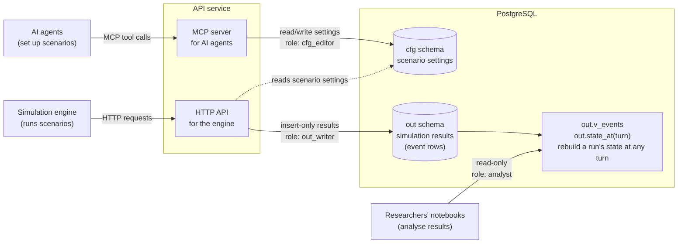

Here's a diagram for the overview. I've used plain descriptive names rather than my shorthand ("agent door" / "engine door"), since new team members won't know those.

How to read it:

- **AI agents** configure scenarios through the **MCP server**, which connects as `cfg_editor` and writes to the `cfg` schema.
- The **simulation engine** reports what happened through the **HTTP API**, which connects as `out_writer` and can only insert rows into `out` — results are never updated or deleted.
- **Researchers** read results from their notebooks as `analyst`, through `out.v_events` and `out.state_at(turn)` rather than the raw tables, so they always see a run's state rebuilt correctly from its events.

Two caveats before this goes into the overview:

1. The dotted line (engine reading its scenario settings from `cfg` via the HTTP API) is my assumption of how the engine gets its configuration — I haven't confirmed that path in this conversation. Please check it or tell me how it actually works and I'll adjust.
2. The `analyst` grants on `v_events` and `state_at` are the next step I haven't done yet, so the researcher arrow shows the intended design, not what's deployed today.

## Verdict

PASS — no `Fails if` line applies; every `Passes if` line holds; no anti-goal tripped.
