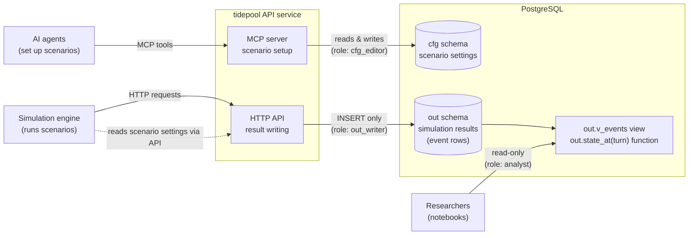

Here's a diagram you can paste into the overview. Since it's for new team members, I've used descriptive names instead of the "agent door" / "engine door" shorthand from my notes. That shorthand isn't defined anywhere they'd look.

How to read it:

- **AI agents** set up scenarios through the **MCP server**. It connects as `cfg_editor` and works only on the `cfg` schema (scenario settings).
- The **simulation engine** writes results through the **HTTP API**. It connects as `out_writer`, which can only add rows to the `out` schema. It can never change or delete them, so a run's history can't be rewritten.
- **Researchers** read results from their notebooks as `analyst`, which is read-only. They read through `out.v_events` and `out.state_at(turn)`, which rebuild what a run looked like at any turn from its event rows, rather than querying the raw tables.

Two things to check before this goes in the overview:

1. **The dotted arrow (engine reads settings).** I've assumed the engine gets its scenario settings through the HTTP API. If it reads `cfg` some other way, tell me and I'll fix that arrow.
2. **The researcher arrow isn't live yet.** The `analyst` grants on `v_events` and `state_at` are the next thing I'm doing, so that read-only access doesn't work today. If the overview goes out before I finish, you could mark it "planned".

## Verdict

PASS — no `Fails if` line applies; every `Passes if` line holds; no anti-goal tripped.
