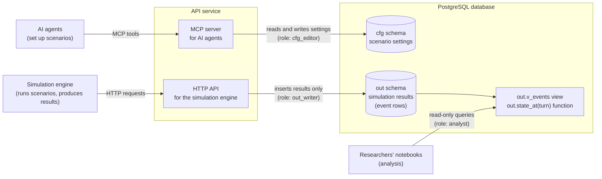

Here's a diagram of how the main parts of tidepool connect. I've used plain names rather than my working shorthand ("agent door" and "engine door"), since new team members won't know those terms:

Some notes for the overview text:

- **Two ways in, one service.** AI agents and the simulation engine both go through the same API service, using different entry points. Agents use an MCP server to set up scenarios. The engine uses an HTTP API to write what a simulation produced.
- **Each caller gets its own database role.** This limits what each caller can do. The MCP server can edit scenario settings (`cfg_editor`). The engine's API can only add rows to `out.*` and can't change or delete them (`out_writer`). Researchers can only read (`analyst`).
- **Results are stored as events, not as current state.** The `out` schema records what happened, turn by turn. To see the state of a run at a given turn, you use `out.state_at(turn)`, which rebuilds it from the events. `out.v_events` is the view for reading the events themselves.

One thing to check first: the `analyst → v_events / state_at` arrow shows the intended setup, but I haven't added those grants yet (that's my next step). If the overview goes out before then, either mark that arrow as planned or wait until the grants are in.

The engine's results go back through the API and the database. The diagram doesn't show the engine reading scenario settings, because I don't know how it does that. If it reads them through the HTTP API too, I can add that arrow.

## Verdict

PASS — no `Fails if` line applies; every `Passes if` line holds; no anti-goal tripped.
