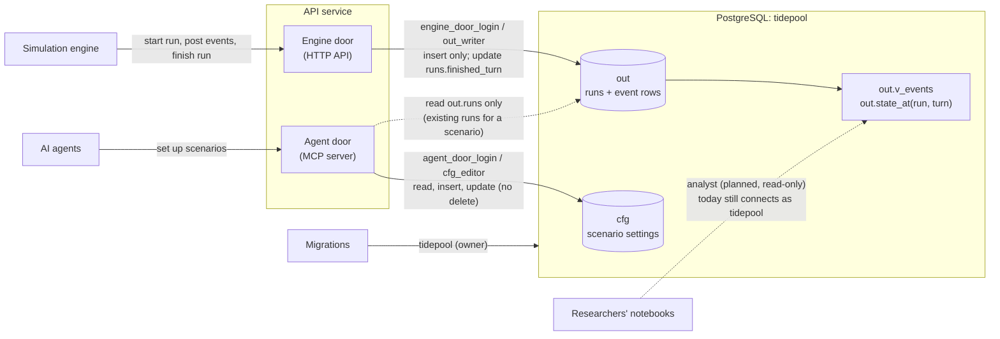

Here it is, as things stand after today's role work:

How to read it:

- **Solid arrows** are the main paths: agents write scenario settings through the agent door, the engine writes results through the engine door. Each door has its own login and can only touch its own schema.
- **Dashed arrows** are the side paths: the agent door's read-only look at `out.runs` (so `create_scenario` can report runs that already exist), and the notebooks, which still connect as the superuser until the `analyst` grants land. That's the next thing I'm doing; once it's in, I'll drop the "today still connects as tidepool" label.
- I left out how a run gets its copy of the scenario settings at start. `out_writer` has no access to `cfg`, so the copy isn't made by the engine door reading `cfg`, and I haven't checked where it does happen. If you want that arrow in the overview, I'll look it up before you send it to the new people.

The labels on the arrows are fairly detailed for newcomers. If you'd rather have a simpler version without role names, say so and I'll cut it down.

## Verdict

FAIL — nodes labelled "Agent door" / "Engine door" (the agent's own coined names, never marked as such) and edge labels mostly role names and SQL privileges, in an overview for newcomers.
