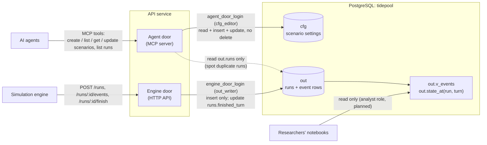

Here's the current picture, as of today's permission work:

How to read it:

- **Two kinds of data.** `cfg` is what a scenario is set up to be; `out` is what a simulation actually produced. `out` is insert-only (ADR-006): a run's history is its event rows, and the only thing ever changed afterwards is `runs.finished_turn` / `status` when a run ends.
- **Two doors, each with its own login.** AI agents set up scenarios through the agent door; the engine writes results through the engine door. Neither door can do the other's job: the agent door has no write path into `out`, and the engine door can't see `cfg` at all.
- **Reading goes through the view and function**, not the raw tables: `out.v_events` and `out.state_at` rebuild a run's state at any turn.

Two things to be aware of before this goes in front of new people:

1. **Notebooks are drawn as they will be, not as they are.** Today `notebooks/_connect.py` (and `tests/reading`) still connect as the `tidepool` superuser; the `analyst` grants on `v_events` / `state_at` are the next thing I'm doing. If the overview goes out before that lands, I'd label that arrow "planned" as above, or I can finish the grants first.
2. **I left out how a run gets its scenario settings on purpose.** I told you earlier that a run copies the settings when it starts, but the engine door's login has no access to `cfg` and the smoke test's `POST /runs` still worked, so the copy must happen somewhere I haven't confirmed (the engine passing settings in, or something else). I'd rather check that than draw an arrow that's wrong. Want me to look before you use it?

Migrations and the `tidepool` owner role aren't in the diagram; they're deployment plumbing rather than one of the parts talking to each other. Happy to add them if the overview covers setup.

## Verdict

FAIL — nodes labelled "Agent door" / "Engine door" (the agent's own coined names, never marked as such) and edge labels mostly role names and SQL privileges, in an overview for newcomers.
