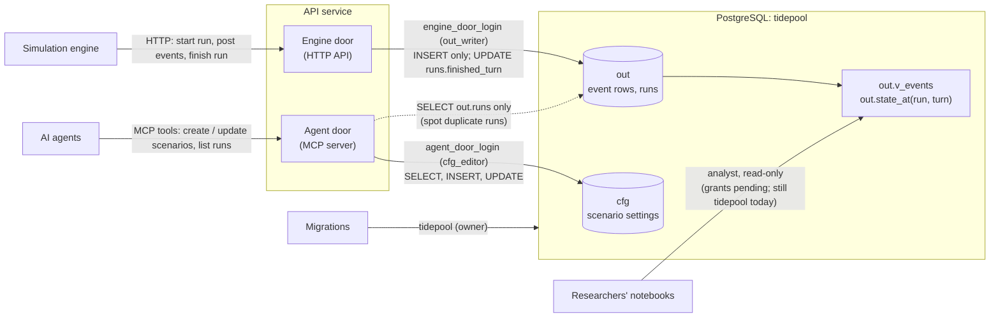

Here's the current picture, with the roles from today's work on the arrows:

How to read it:

- **Two doors, one database.** AI agents set up scenarios through the agent door; the engine writes results through the engine door. Neither talks to Postgres directly.
- **Each door has its own login with the minimum it needs.** The agent door can edit `cfg` and only *read* `out.runs` (so `create_scenario` can say "a run with these settings already exists"). The engine door can only append to `out`, plus set `finished_turn` when a run ends; it can't update or delete events, and it can't see `cfg` at all.
- **Reading goes through `v_events` and `state_at`**, which rebuild a run's state at any turn from its event rows.
- **`tidepool` is now only the migration owner**, plus the two leftovers below.

One caveat before this goes into the overview for Monday: the notebooks arrow (and `tests/reading`) still connects as the `tidepool` superuser. The `analyst` grants on `v_events` and `state_at` are the next thing I'm doing. If you'd rather the diagram show only what's true today, I can redraw that arrow as `tidepool` and you can update it once analyst lands. Want me to finish the analyst grants first so the diagram is just correct?

## Verdict

FAIL — nodes labelled "Agent door" / "Engine door" (the agent's own coined names, never marked as such) and edge labels mostly role names and SQL privileges, in an overview for newcomers.
