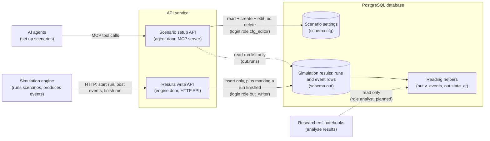

Here's the diagram, written for people who have never seen tidepool. Each box says what the part does, with its name in the code in brackets.

How to read it:

- **Solid arrows** are the main traffic. **Dotted arrows** are smaller or not finished yet.
- **Roles** are PostgreSQL logins with limited rights. Each door connects as its own role, so the database itself refuses anything outside that door's job. For example, the results API cannot update or delete event rows, and the setup API cannot write results at all.
- **Event rows** are the simulation's history. They are only ever added, never changed. `out.v_events` (a view) and `out.state_at` (a function) rebuild what a run looked like at any turn from those rows.

What's built and what isn't, as of today:

- Both doors, their roles and the solid arrows are built and tested. All 42 tests pass, and I smoke-tested both doors end to end on their own logins.
- The notebooks arrow is **not built yet**. The `analyst` grants are my next step. Until then, notebooks and the reading tests still connect as the superuser. If the overview goes out before I finish, label that arrow "planned".
- One thing I left out on purpose: I haven't checked how the engine gets a scenario's settings when a run starts. The results API has no access to `cfg`, so the settings must arrive some other way, probably in the start-run request, but I haven't confirmed that. I can look it up and add the arrow if you want it in the overview.

The diagram leaves out the migrations, which run as the database owner `tidepool` and only change the schema, not the data flow.

## Verdict

PASS (draft 3, strict) — every node label leads with what the part does; "agent door"/"engine door" and role names only in brackets beside it.
