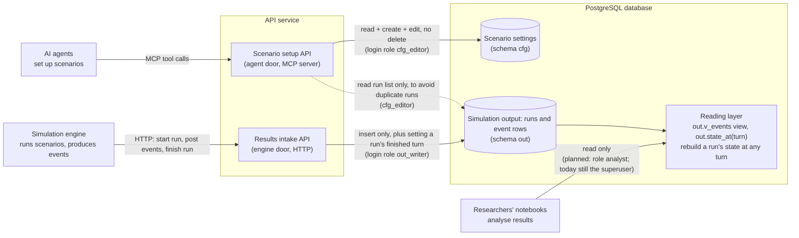

Here's the diagram. It shows how things connect after today's permission work. Each box is labelled by what it does, with the project's name for it in brackets, so it should make sense to someone starting on Monday.

How to read it:
- **Doors.** The API service has two entry points, which we call "doors". AI agents use one to set up scenarios. The simulation engine uses the other to write results. Neither caller connects to the database directly.
- **Roles.** Each door logs in to PostgreSQL as its own role, and that role can only do what the door needs. The engine's role can add output rows but never change or delete them: output is append-only (ADR-006). The one exception is marking a run finished.
- **Reading.** Rows in `out` are a log of events, not a current state. To see what a run looked like at a given turn, read through `out.v_events` and `out.state_at`. Don't query the tables directly.

What this is based on: the roles and the arrows from the doors match the grants I checked today with `\dp` and the tests that passed. The notebook arrow is the plan, not the current state. Notebooks and `tests/reading` still connect as the superuser `tidepool` because the analyst grants aren't done yet. Put a "planned" note on that arrow if the overview goes out before then.

There's one gap I can't explain yet, so I left it out of the diagram. Earlier I said a run copies the scenario settings when it starts. But the engine door's role has no access to `cfg` (I confirmed that with the "permission denied for schema cfg" check), and the engine-door smoke test still started a run on scenario 41. So the settings probably reach the run some other way, maybe in the engine's request. I haven't checked which. I'll look at how `POST /runs` gets the settings and fix either the diagram or my earlier answer.

## Verdict

PASS (draft 3, strict) — every node label leads with what the part does; "agent door"/"engine door" and role names only in brackets beside it.
