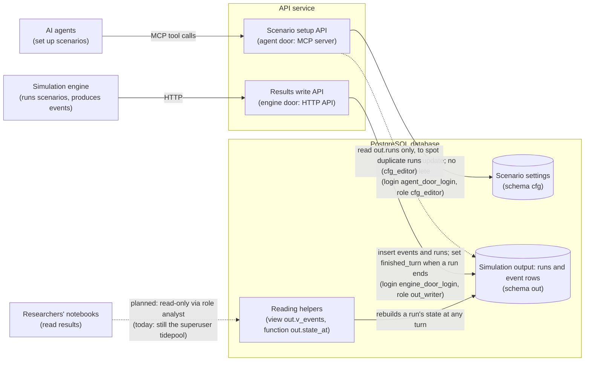

Here's how the parts connect after today's role changes. Each box is labelled by what it does, with its name in the code in brackets.

How to read it:

- **Solid arrows** are in place now and tested: `make test` passed 42 of 42, and I ran smoke tests through both doors.
- **Dotted arrows** are limited or not finished. The agent door can read one table in `out` and can't write to it. The notebook connection is planned: the `analyst` grants aren't written yet, so notebooks and `tests/reading` still connect as the superuser.
- **Engine reads of settings:** a run copies its scenario settings when it starts, and the engine door never reads `cfg` after that. That's why there's no arrow from the engine door to `cfg`.
- **What's left out:** the migrations still run as the owner role `tidepool`. That's setup work, not runtime traffic.

A correction for the overview. Earlier I said "out_writer can only INSERT into out.*", and that was too loose. The engine door's role `out_writer` can also read four columns of `out.events` (needed for `INSERT … RETURNING` and for skipping duplicate inserts). It can also update one column, `out.runs.finished_turn`, when a run ends. It can't change or delete event rows, and I checked that by hand and in `tests/db/test_grants.sql`.

Two things I noticed while drawing this and haven't checked yet:

1. ADR-006 (the decision record that makes output insert-only) lists `out.runs.status` as a column the writer sets when a run ends. I only granted UPDATE on `finished_turn`. Either finishing a run doesn't touch `status`, or nothing tests that path yet.
2. Migration 023 grants read access on four `out.events` columns (`event_id`, `run_id`, `turn`, `seq`), but the permissions listing only showed two. That may just be how the listing displays them. I'd confirm before anyone relies on it.

I can look into both before I start on the `analyst` grants if you want.

## Verdict

PASS (draft 3, strict) — every node label leads with what the part does; "agent door"/"engine door" and role names only in brackets beside it.
