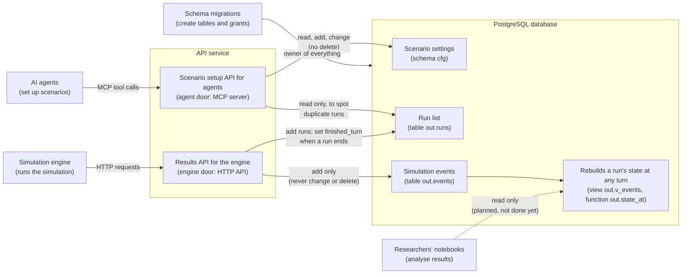

Here's the diagram. It shows the setup as it stands after today's permission work. Since it's for new people, each box says what the part does first, with the code name in brackets.

How to read it:

- **Two doors.** The API service has two entry points. AI agents use the *agent door*, an MCP server (MCP is the protocol AI tools use to call functions), to create and change scenarios. The simulation engine uses the *engine door*, an ordinary HTTP API, to record what happened in a run.
- **Two schemas.** `cfg` holds scenario settings and `out` holds what simulations produced. Rows in `out` are only ever added, never changed, because a run's history is its event rows (ADR-006). The one exception is that a run's end turn and status get set when it finishes.
- **Arrow labels are database permissions.** Each door logs in as its own database user (`agent_door_login`, `engine_door_login`), and that user can only do what the arrow says. The tests and the manual checks from today confirm this. For example, the engine door's login can't delete or update events and can't read `cfg` at all.

What isn't settled yet:

- **Notebooks (dashed arrow).** These still connect as the `tidepool` superuser today, and so do the reading tests. The read-only `analyst` role for `v_events` and `state_at` is what I'm working on next. Once it's in place, the dashed arrow becomes the real path.
- **Migrations.** These run as `tidepool`, which owns all the tables. That's intended and stays that way.
- **Status is missing from the diagram.** ADR-006 lists `status` on `out.runs` as mutable too, but I only granted the engine door UPDATE on `finished_turn`. Its tests pass, so I don't think it sets `status` through that path, but I haven't checked. I'll confirm before you put this in the overview.

I've drawn the doors as two boxes inside one service because that's how the notes describe them. If you'd rather show them as two separately deployed services (they're separate containers in compose), I can redraw it.

## Verdict

PASS (draft 3, strict) — every node label leads with what the part does; "agent door"/"engine door" and role names only in brackets beside it.
