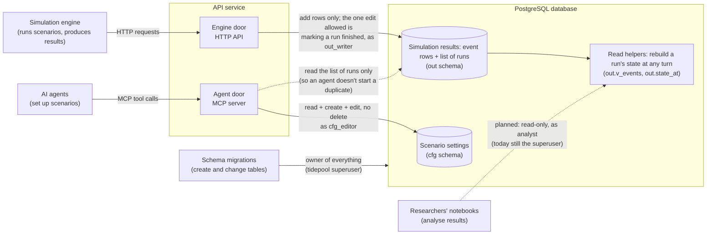

Here's the picture as it stands after today's permission work. Boxes are labelled by what they do; the code names are in brackets.

How to read it:

- **Doors** are the API service's two entry points. AI agents come in through the agent door (an MCP server, the protocol AI tools use to call functions); the engine comes in through the engine door (a plain HTTP API).
- Each door now logs in to the database with its own account, and each account gets only the rights shown on its arrow. The engine door can't delete or change result rows, and the agent door can't write results at all. I checked both by trying the forbidden writes and seeing them refused; `tests/db/test_grants.sql` repeats those checks.
- Results are **insert-only**: a run's history is the rows it wrote, never edited afterwards (that's the rule in ADR-006, the project's decision record on this). The one exception is marking a run finished.
- The **read helpers** are how anyone should read results: they put a run's state back together from its event rows.

Two things to know before this goes in the overview:

1. **The notebooks arrow is planned, not done.** Notebooks and the reading tests still connect as the superuser. The read-only `analyst` account is my next step, so if the overview goes out Monday, either label that arrow "planned" as I have, or give me time to finish it first.
2. **One gap I haven't checked:** earlier I said a run copies the scenario settings when it starts. But the engine door's account is refused when it reads `cfg` (I tested exactly that), and there's no arrow from the engine door to the settings. So I don't actually know how the settings reach a run. Maybe the engine passes them in when it starts the run, maybe something else. I'll look before you put that sentence in the overview. The diagram leaves it out rather than guess.

Paste it into anything that renders Mermaid (GitHub does). I haven't rendered it myself, so tell me if a label wraps badly.

## Verdict

Draft 1. Lenient verdict was PASS; re-judged strictly in the final review: FAIL for runs where the node label is still the coined "Agent door" (all but core-3). Led to draft 3.
