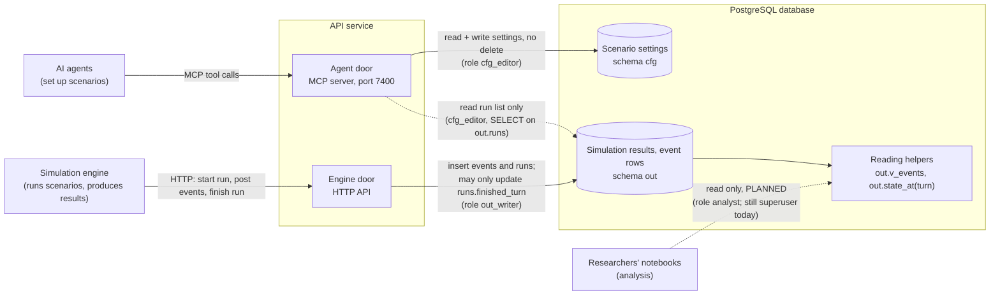

Here's the diagram. Each box is labelled by what it does, with the code name in brackets. The arrows show the database permissions as they stand after today's work.

How to read it:

- **Two entry points to one service.** AI agents reach the API service through the "agent door", an MCP server (MCP: Model Context Protocol, the standard way AI agents call tools). The simulation engine writes its results through the "engine door", a plain HTTP API. "Agent door" and "engine door" are our names for the two entry points; they appear in the config files (`config/agent_door.toml`, `config/engine_door.toml`) and in the test folders.
- **Two areas in the database.** `cfg` holds scenario settings. `out` holds what the simulations produced, as event rows. Event rows are only ever added, never changed or deleted (ADR-006, the project's decision record on this). The one exception is the end of a run, when its finishing turn is recorded.
- **Each door logs in as its own limited database role.** Until today both doors logged in as the superuser. Now the agent door can only read and write settings, plus read the list of runs (so `create_scenario` can point out existing runs instead of starting a duplicate). The engine door can only add rows to `out` and set `finished_turn` when a run ends. Neither door can reach the other's area for writing.
- **Reading.** `out.v_events` (a view) and `out.state_at(turn)` (a function) rebuild a run's state at any turn from its event rows. Analysis should go through these rather than through the raw tables.
- **The engine doesn't read settings back.** A run copies its scenario's settings when it starts, so changing a scenario later doesn't affect a run that's already going.

Two things to know before this goes into the overview:

1. **The notebook arrow is planned, not built.** The read-only `analyst` role exists but has no permissions yet. Notebooks and the reading tests still connect as the superuser. I'm on that next.
2. **One correction to what I said earlier.** I told you the engine door "can only INSERT into out.*". That's not quite right: it can also update the one column `out.runs.finished_turn`, which is how a run gets marked finished. ADR-006 also lists `out.runs.status` as changeable when a run ends, but I haven't granted that, and the tests pass without it. Either the engine door never sets `status` or no test covers it. I haven't checked which.

What I checked: the permissions in the diagram come from the database's own permission listing and the negative tests in `tests/db/test_grants.sql`, and both doors were smoke-tested end to end under their new logins. I haven't rendered the diagram, so preview it in something that supports Mermaid (GitHub does) before you paste it in.

## Verdict

Draft 1. Lenient verdict was PASS; re-judged strictly in the final review: FAIL for runs where the node label is still the coined "Agent door" (all but core-3). Led to draft 3.
