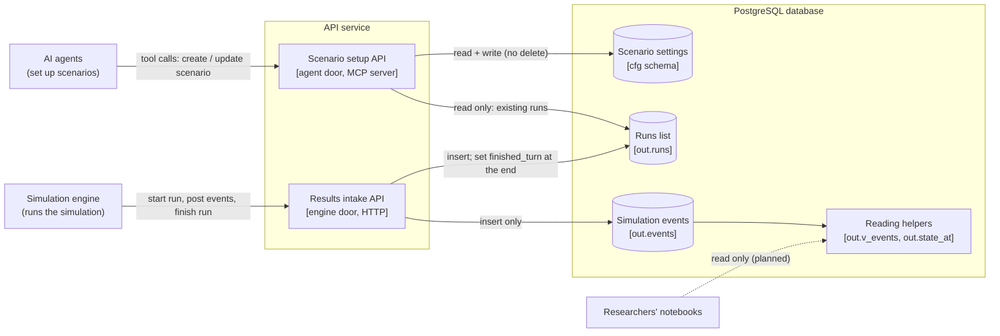

Here it is. Boxes are named by what they do, with our code names in brackets, so you can paste it into the overview as is:

How to read it:
- **Agent door / engine door** are the two ways into the API service. AI agents use the first to set up scenarios; the simulation engine uses the second to write what a run produced.
- **cfg / out** are the two parts of the database: `cfg` holds scenario settings, `out` holds what simulations produced. `out` is add-only: rows are never changed or deleted, except a run's end turn and status.
- **Reading helpers**: `out.v_events` (a view) and `out.state_at(turn)` rebuild a run's state at any turn from its event rows.

What it rests on: the arrows from both doors match the permissions I set and tested today (tests green, smoke tests for both doors). The researchers' arrow is dotted because it isn't true yet: notebooks still connect as the superuser, and the read-only role for them is the next thing I'm doing.

One thing I left out on purpose, because I can't square it: earlier I told you a run copies its scenario's settings when it starts, and that's why editing settings mid-run is safe. But the engine door now has no access to `cfg` at all (the check returned "permission denied for schema cfg"), and the smoke-test run still started fine. So either the engine sends the settings itself when it starts a run, or the copy doesn't happen the way I said. I haven't checked which. I'd like to look at what starting a run actually does before you put that arrow, or that "safe mid-run" claim, in front of new people. Want me to do that first, before the read-only role?

## Verdict

Draft 1. Lenient verdict was PASS; re-judged strictly in the final review: FAIL for runs where the node label is still the coined "Agent door" (all but core-3). Led to draft 3.
