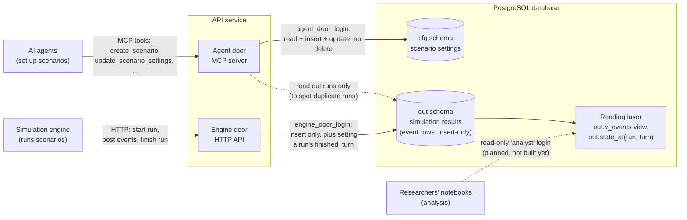

Here's the diagram. It shows the setup as it stands after today's permission changes. Each arrow is labelled with the database login it uses and what that login is allowed to do.

How to read it:

- **Doors** are what we call the two entry points of the API service. AI agents use the agent door to set up scenarios. The simulation engine uses the engine door to write what a run produced.
- **cfg** and **out** are the two parts of the database: settings, and results. Results are never changed or deleted after they are written. The one exception is that a run's end turn (`finished_turn`) is filled in when the run ends. That rule is ADR-006 (the project's decision records are called ADRs).
- **Solid arrows** are real, tested connections. **Dotted arrows** are either a narrow read-only access (the agent door can look at the list of runs) or not built yet (the analyst login).

What's real today and what isn't, for the overview:

- Both doors already connect with their own restricted logins. The tests pass, and I ran a smoke test of each one by hand.
- Notebooks and the reading tests still connect as the `tidepool` superuser. The `analyst` login exists, but it has no permissions yet. That's my next step. If the overview goes out before then, either leave the notebooks arrow out or keep it marked "planned".
- Migrations (the numbered scripts that build the schema) run as `tidepool`, which owns every table. I left this out of the diagram because it's deployment rather than how the parts talk to each other. Tell me if you want it added.

Two things I noticed while drawing this that I haven't checked, so I don't want them in the overview yet:

- Earlier I said a run copies its settings from cfg when it starts. But the engine's login is refused access to cfg, and starting a run still worked in the smoke test. So the copy happens somewhere I haven't traced, maybe in the agent door or in the API service before the switch to the restricted login. I'll find where before you describe it to new people.
- I told you the engine's login can only insert. Strictly speaking, it can also set `finished_turn`. ADR-006 also lists the run's `status` as changeable, but I didn't grant that, so finishing a run might not record its status. Also, the permissions listing shows read access on only two of the four event columns I granted. Possibly that's just how the output was cut off, but I'll check it alongside the analyst work.

## Verdict

Draft 1. Lenient verdict was PASS; re-judged strictly in the final review: FAIL for runs where the node label is still the coined "Agent door" (all but core-3). Led to draft 3.
