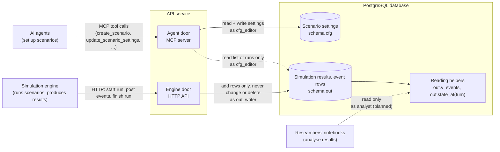

Here's the diagram. It shows the setup as of today's permission changes, so it's ready for the overview. Each box says what the part does, with its name in the code next to it.

How to read it:

- **Two doors, one database.** The API service has two entry points. The *agent door* is an MCP server (MCP is the protocol AI agents use to call tools); agents use it to create and edit scenarios. The *engine door* is an ordinary HTTP API; the simulation engine uses it to write what a run produced.
- **Two schemas.** `cfg` holds scenario settings. `out` holds what simulations produced. Results are only ever added, never changed or deleted. The one exception is a run's end marker, `out.runs.finished_turn`.
- **The labels on the arrows are database roles,** meaning which Postgres login each door connects as and what that login is allowed to do. Since today each door has its own restricted login. Before, everything connected as the superuser.
- **The dotted agent-door arrow** is there because `create_scenario` shows the runs that already exist for the same settings, so an agent doesn't start a duplicate. That arrow is read-only and limited to the list of runs.
- **Reading helpers:** `out.v_events` (a view) and `out.state_at(turn)` (a function) rebuild a run's state at any turn from its event rows. Notebooks are meant to read results through these.

Two caveats before this goes in front of new people:

1. **The notebooks arrow isn't true yet.** Notebooks and the reading tests still connect as the superuser, because I haven't written the `analyst` grants. That's next on my list. Once it's done the diagram will match what's running. If the overview goes out first, you could drop "(planned)" from the label after it lands, or I can tell you when.
2. **I left out how a run gets its settings.** A run copies its scenario's settings when it starts. But the engine door's login can't read `cfg` (I tested that), so I'm not sure which part does the copying, and I didn't want to guess and draw it wrong. I can check if you want that arrow in.

I haven't rendered the diagram, so it's untested as Mermaid. The syntax is standard flowchart syntax, but give it a quick look in your Markdown preview.

## Verdict

Draft 1. Lenient verdict was PASS; re-judged strictly in the final review: FAIL for runs where the node label is still the coined "Agent door" (all but core-3). Led to draft 3.
